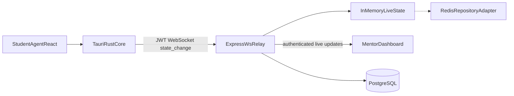

# FocusMentor Architecture

## Overview

## Packages

| Path | Role |
|------|------|
| `packages/contracts` | Shared Zod schemas, focus states, WS/REST contracts |
| `backend` | Express REST + `ws` relay, Prisma/PostgreSQL |
| `dashboard` | Mentor UI (Vite/React/Tailwind/React Query/Zustand) |
| `student-agent` | Tauri v2 native agent (Rust + React); Windows + Linux X11 |

## Foreground detection

| Platform | Provider | Notes |
|----------|----------|-------|
| Windows | `GetForegroundWindow` + process name | Window title used for local Debug only |
| Linux X11 | `xdotool` (active window PID + process name) | Requires `xdotool`; titles local Debug only |
| Linux Wayland / other | Explicit unsupported capability | Fail closed — no stub / fake apps |

Only `clientType: native_student_agent` may publish student `state_change` events. Browser preview cannot join.

## Privacy boundary

Collected during an active session only:

- Foreground executable basename (e.g. `Code.exe`, `cursor`)
- Normalized display name (e.g. `VS Code`)
- Focus state enum
- Timestamp of state changes / heartbeats

Never collected:

- Screen / screenshots / audio
- Keystrokes / clipboard
- Files / code / browser history
- Window titles (read locally for Debug; never sent over WebSocket or stored)
- URLs

Domain allow/block lists exist in configuration for future clients. The MVP agent reports `domainMatchingSupported: false`.

## Session lifecycle

1. Mentor creates session → pairing code (single-use).
2. Student consents (local) → joins with code → receives JWT + in-memory config.
3. Agent starts 2s foreground polling + WebSocket only while session is active.
4. On leave/end/expiry: stop polling, disconnect WS, clear session memory immediately.
5. Optional aggregate summary (app minutes + state %) retained for configurable hours, then deleted.

## Live state

`LiveStateStore` is an in-memory interface. Swap in Redis without changing service call sites.

## Auth

- Mentors: HTTP-only cookie JWT + CSRF header for cookie-based mutations; Bearer tokens accepted for API tooling.
- Students: short-lived JWT bound to `sessionId`; invalidated effectively when session status becomes `ended` / expired.
- Dashboard WebSocket: short-lived `ws_ticket` JWT.
