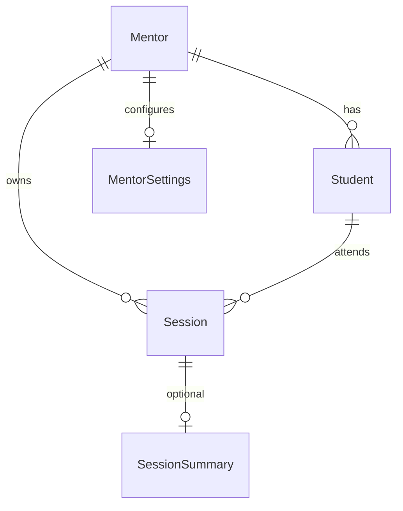

# Database schema

PostgreSQL via Prisma. Live student focus state remains in-memory (Redis-ready).

## ERD

## Tables

### Mentor

- `id` UUID PK
- `email` unique
- `passwordHash`
- `name`
- timestamps

### Student

- `id` UUID PK
- `mentorId` FK
- `name`, optional `email`

### MentorSettings

Defaults for allow/block lists, duration, summary flags, retention hours.

### Session

- Pairing code stored as SHA-256 hash; plaintext kept only until first successful join
- `status`: `pending` | `active` | `ended`
- `configJson`: session config (apps/domains/summary flags) — never titles/URLs/keystrokes
- `expiresAt`, `endedAt`

### SessionSummary

Aggregate-only counters + `appDurationsJson` like `[{ "appName": "VS Code", "seconds": 2520 }]`.
Deleted when `retainUntil` passes.

## Future Redis

Implement `LiveStateStore` with Redis hashes/keys:

- `session:{id}:live` → current state fields
- `session:{id}:config` → JSON config
- TTL aligned with session expiry
